# Implementation Plan: Restructuring Typikon Coded to the 6-Tier Ecosystem Archetype

This plan details the systematic restructuring of **Typikon Coded** to conform strictly to the **6-Tier Spoke Archetype** and **Ecosystem Architectural Standard** (`C:\Users\augus\OneDrive\Documents\Google Antigravity\Projects\ECOSYSTEM_ARCHITECTURAL_STANDARD.md`), incorporating the architectural decisions confirmed during our alignment interview.

---

## 1. Goal Description

Restructure the **Typikon Coded** workspace from an unconstrained root layout with loose test outputs, legacy prototype folders, and unindexed audits into a strict, standardized **6-Tier Archetype**:

```
Typikon Coded/
├── .agents/                    # Tier 1: Agent Governance, Master Rules, Skills
├── _brain/ & _dedup_meta/      # Tier 2: Reorg manifest, state machines, LIFO rollback
├── data/                       # Tier 3: databases/ (json_db), rubrics/, schemas/, prototypes/, historical_data_caches/, Data/Inbox/
├── reports/                    # Tier 4: audits/, digests/, traces/, final_results/, historical_artifacts/
├── scripts/ & tests/           # Tier 5: engine/, digest/, tests/, parsers/, operational pipelines
└── scratch/                    # Tier 6: logs/, temporary debug probes, .archive/
```

### Confirmed Decisions from `/grill-me`:
1. **`cantor_dashboard/`**: Move to `data/prototypes/cantor_dashboard/` and update `tests/test_server_endpoints.py` to point to the new location.
2. **`json_db/` & `Rubrics/`**: Move `json_db/` to `data/databases/json_db` and `Rubrics/` to `data/rubrics/`. Create root symlinks/directory junctions (`json_db -> data/databases/json_db`, `Rubrics -> data/rubrics`) so all 1,408 tests continue passing without requiring fragile mass codebase search-and-replace.
3. **`schemas/` & `parsers/`**: Move `parsers/` to `scripts/parsers/` and `schemas/` to `data/schemas/` (with a root symlink `schemas -> data/schemas` for jsonschema validators).
4. **Core Packages**: `engine/`, `digest/`, `scripts/`, and `tests/` remain as Tier 5 operational code at project root.
5. **Two-Tier Intake Standard**: Formalize `Data/Inbox/` with `.gitkeep` and a dedicated `README.md` defining Drive C (machine-readable) vs. Drive E (media/scans).
6. **Atomic LIFO Rollback**: Record all file movements in `_dedup_meta/reorg_manifest.json` with an automated rollback script `_dedup_meta/rollback_reorg.py`.

---

## 2. Architecture & 6-Tier Target Topology

```mermaid
flowchart TD
    subgraph Root ["Typikon Coded Root (Clean 6-Tier Layout)"]
        A[".agents/ (Governance & Skills)"]
        B["_dedup_meta/ (Manifest & Rollback)"]
        C["data/ (Databases, Schemas, Prototypes, Inbox)"]
        D["reports/ (Digests, Audits, Traces)"]
        E["scripts/ & tests/ (Core Engine, Digest, Tests)"]
        F["scratch/ (Logs & Temporary Buffers)"]
    end

    subgraph DataTier ["Tier 3: data/"]
        C1["data/databases/json_db (Root junction: json_db/)"]
        C2["data/schemas/ (Root junction: schemas/)"]
        C3["data/rubrics/ (Root junction: Rubrics/)"]
        C4["data/prototypes/cantor_dashboard/"]
        C5["data/prototypes/cantor_prototypes/"]
        C6["data/historical_data_caches/"]
        C7["Data/Inbox/ (Two-Tier Intake Gating)"]
    end

    subgraph ReportsTier ["Tier 4: reports/"]
        D1["reports/digests/ (Loose Digest_*.md & generated_digests/)"]
        D2["reports/audits/ (Loose audit_*.json & audit_results/)"]
        D3["reports/traces/ (Service_*.txt, Logic_Trace_*.txt, verification_examples/)"]
        D4["reports/final_results/ (from final_results/)"]
        D5["reports/historical_artifacts/"]
    end

    subgraph CodeTier ["Tier 5: Core Hub Engine & Scripts"]
        E1["engine/ (Ruthenian Liturgical Logic)"]
        E2["digest/ (Digest Formatting Mixins)"]
        E3["scripts/ (Pipelines & Compilers)"]
        E4["scripts/parsers/ (from parsers/)"]
        E5["scripts/legacy_runners/ (generate_cantor_prototype.py, etc.)"]
        E6["tests/ (1,408-Test Deterministic Suite)"]
    end

    C --> C1 & C2 & C3 & C4 & C5 & C6 & C7
    D --> D1 & D2 & D3 & D4 & D5
    E --> E1 & E2 & E3 & E4 & E5 & E6
```



---

## 3. Step-by-Step Execution Plan

### Step 1: Pre-Flight Checklist
- Read `.agents/AGENTS.md` and `.agents/references/project_facts.md`.
- Verify `.agents/references/learnings.md` and `.agents/references/anti_patterns.md`.
- Cite Rule 6 (Evidence Gate) and Rule 10 (UTF-8 & Dynamic Paths).
- Run session compliance test:
  `$env:PYTHONPATH="." ; & .venv\Scripts\python.exe -m pytest tests/test_session_compliance.py --verbose`

### Step 2: Establish Base 6 Tiers & Safe Manifest
- Create directories:
  - `_dedup_meta/`
  - `data/databases/`
  - `data/schemas/`
  - `data/rubrics/`
  - `data/prototypes/`
  - `Data/Inbox/`
  - `reports/digests/`
  - `reports/audits/`
  - `reports/traces/`
  - `reports/final_results/`
  - `scripts/parsers/`
  - `scripts/legacy_runners/`
  - `scratch/logs/`
- Initialize `_dedup_meta/reorg_manifest.json`.

### Step 3: Relocate Legacy & Prototype Directories
- Move `cantor_dashboard/` -> `data/prototypes/cantor_dashboard/`.
- Move `cantor_prototypes/` -> `data/prototypes/cantor_prototypes/`.
- Move `audit_results/` -> `reports/audits/legacy_audit_results/`.
- Move `final_results/` -> `reports/final_results/`.
- Move `generated_digests/` -> `reports/digests/generated_digests/`.
- Move `verification_examples/` -> `reports/traces/verification_examples/`.
- Move `archive/` -> `scratch/.archive/` (or `data/archive/`).
- Record each operation in `_dedup_meta/reorg_manifest.json`.

### Step 4: Lock Core Engines & Databases
- Move `json_db/` -> `data/databases/json_db` and establish root directory junction `json_db -> data/databases/json_db`.
- Move `schemas/` -> `data/schemas` and establish root directory junction `schemas -> data/schemas`.
- Move `Rubrics/` -> `data/rubrics` and establish root directory junction `Rubrics -> data/rubrics`.
- Move `parsers/` -> `scripts/parsers/`.
- Update `tests/test_server_endpoints.py` to point to `os.path.join(REPO_DIR, "data", "prototypes", "cantor_dashboard", "server.py")`.

### Step 5: Triage & Relocate Loose Root Files
- **Digests -> `reports/digests/`**:
  `Digest_2025-12-31.md`, all `Digest_2026-*.md`, `digest_output.md`.
- **Audits & Analyses -> `reports/audits/`**:
  `audit_35_keys_results.json`, `decadal_audit_results.json`, `golden_window_50yr_results.json`, `temple_collision_audit_results.json`, `scan_2026_systemic_bugs_report.json`, `wing1_audit_report.md`, `wing2_audit_report.md`, `deepseek_response.md`, `gui_features_roadmap.md`.
- **Traces & Logs -> `reports/traces/`**:
  `Service_2026-*.txt`, `Logic_Trace_2026-03-15.txt`, `git_log_calendar.txt`, `git_log_calendar_utf8.txt`.
- **Legacy Runners -> `scripts/legacy_runners/`**:
  `generate_cantor_prototype.py`, `generate_typikon_service.py`, `ruthenian_engine.py`, `typikon_digest_generator.py`.
- Clean temporary test logs: `test_execution_log.json` -> `scratch/logs/`.

### Step 6: Enforce Two-Tier Intake Standard
- Ensure `Data/Inbox/.gitkeep` exists.
- Create `Data/Inbox/README.md` defining:
  - **Drive C (`Data/Inbox/`)**: Machine-readable JSON, MD, XML, MEI payloads.
  - **Drive E (`E:\Google Drive\Liturgical Library\_INCOMING_INBOX`)**: Canonical PDFs, high-res scans, TIFFs, audio.
  - Automatic transfer and ingestion protocols.

### Step 7: Build Rollback Script & Verify Invariants
- Generate `_dedup_meta/rollback_reorg.py` reading `_dedup_meta/reorg_manifest.json` in reverse (LIFO).
- Run full pytest suite:
  `$env:PYTHONPATH="." ; & .venv\Scripts\python.exe -m pytest --ignore=tests/test_ui_readability.py`
  Verify that **1,408 tests pass with 0 regressions**.
- Verify `tests/test_server_endpoints.py` passes with the relocated `cantor_dashboard`.

---

## 4. Verification Plan

### Automated Tests
```powershell
# 1. Compliance verification
$env:PYTHONPATH="." ; & .venv\Scripts\python.exe -m pytest tests/test_session_compliance.py --verbose

# 2. Server endpoint check at new path
$env:PYTHONPATH="." ; & .venv\Scripts\python.exe -m pytest tests/test_server_endpoints.py -v

# 3. Full test suite regression verification
$env:PYTHONPATH="." ; & .venv\Scripts\python.exe -m pytest --ignore=tests/test_ui_readability.py
```

### Manual Verification
- Verify project root: Only standard project files (`README.md`, `requirements.txt`, `render.yaml`, `.gitignore`) and the 6 tier roots remain.
- Verify `_dedup_meta/reorg_manifest.json` logs all moves.
- Verify `Data/Inbox/README.md` accurately documents the Two-Tier intake standard.
