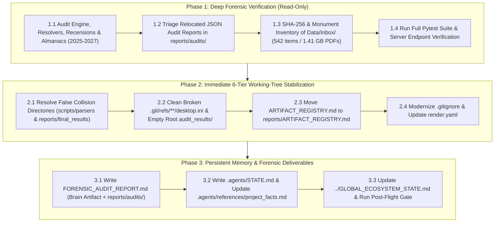

# Forensic Exploration, 6-Tier Stabilization & State Reconstruction Plan (`Typikon Coded`)

## 1. Goal & Locked Architectural Decisions

Following our `/grill-me` design interview and pre-flight inspection, this plan executes both a **comprehensive bottom-up Forensic Audit** of `Typikon Coded` and **Immediate 6-Tier Working-Tree Stabilization**, establishing permanent situational awareness across Antigravity sessions.

> [!IMPORTANT]
> ### Locked Decisions from Design Interview
> 1. **Target Scope**: Execute the full **Forensic Audit** (`FORENSIC_AUDIT_REPORT.md`) **AND** **Immediate 6-Tier Stabilization**, while cataloging `Data/Inbox/` for a dedicated Phase 2 ingestion run.
> 2. **6-Tier `.gitignore` Modernization**: Replace the legacy blanket `Data/` ignore in [`.gitignore`](file:///c:/Users/augus/OneDrive/Documents/Google%20Antigravity/Projects/Typikon%20Coded/.gitignore) with selective ignores (`Data/Inbox/`, `Data/Service Books/`, `Data/historical_data_caches/`, `Data/archive/`, `Data/*.pdf`, `Data/*.txt`) so that `Data/prototypes/cantor_dashboard/`, `Data/databases/chronicle_index.json`, and the 18 ingested Kyivan Musicology JSON databases in `Data/` are tracked in Git. Keep `json_db/`, `schemas/`, and `Rubrics/` tracked once via their root paths (avoiding duplicate Git tracking inside `Data/databases/json_db/`, `Data/schemas/schemas/`, and `Data/rubrics/Rubrics/`). Update [`render.yaml`](file:///c:/Users/augus/OneDrive/Documents/Google%20Antigravity/Projects/Typikon%20Coded/render.yaml) to `python Data/prototypes/cantor_dashboard/server.py`.
> 3. **177 MB Sept 30 Brain Harvest Hygiene**: Relocate [`ARTIFACT_REGISTRY.md`](file:///c:/Users/augus/OneDrive/Documents/Google%20Antigravity/Projects/Typikon%20Coded/ARTIFACT_REGISTRY.md) (1.43 MB) from root into `reports/ARTIFACT_REGISTRY.md` (enforcing the 6-Tier Root Read-Only Law) and track it in Git, while gitignoring the bulk harvested archives (`docs/historical_artifacts/` [66.2 MB], `docs/user_evidence/` [103.5 MB], and `scripts/archived_pipelines/` [7.2 MB]).
> 4. **1.41 GB `Data/Inbox/` PDFs & Duplicate Monuments**: Perform a strictly read-only SHA-256 duplicate and Drive-E routing audit of `Data/Inbox/` (including the 202 duplicate PDFs in `Data/Inbox/` vs. `Data/Inbox/PDFs/`, and the draft vs. final folders for `1891_Lviv_Synod` and `1910_Skaballanovich_Typikon`) and publish the exact manifest in `FORENSIC_AUDIT_REPORT.md` before any `Data/Inbox/` cleanup.
> 5. **Persistent Antigravity State Memory**: Create `.agents/STATE.md`, update [`.agents/references/project_facts.md`](file:///c:/Users/augus/OneDrive/Documents/Google%20Antigravity/Projects/Typikon%20Coded/.agents/references/project_facts.md) (so Rule 11 Pre-Flight automatically loads the October 2026 baseline and links `.agents/STATE.md`), and append the Hub forensic & stabilization milestone to [`../GLOBAL_ECOSYSTEM_STATE.md`](file:///c:/Users/augus/OneDrive/Documents/Google%20Antigravity/Projects/GLOBAL_ECOSYSTEM_STATE.md).

---

## 2. Execution Architecture



---

## 3. Proposed Changes by Component

### Component 1: Immediate 6-Tier Directory & Git Ref Stabilization

1. **Resolve False Collision Directories from October 5 Reorganization**:
   - Move the 18 parser scripts from `scripts/parsers_collision_20261005115528/` into the empty `scripts/parsers/` directory, remove the empty `scripts/parsers_collision_20261005115528/` folder, and update [`_dedup_meta/reorg_manifest.json`](file:///c:/Users/augus/OneDrive/Documents/Google%20Antigravity/Projects/Typikon%20Coded/_dedup_meta/reorg_manifest.json).
   - Move the 5 files from `reports/final_results_collision_20261005115528/` into the empty `reports/final_results/` directory, remove `reports/final_results_collision_20261005115528/`, and update `_dedup_meta/reorg_manifest.json`.
   - Fix the collision bug in [`scripts/execute_spoke_reorg.py`](file:///c:/Users/augus/OneDrive/Documents/Google%20Antigravity/Projects/Typikon%20Coded/scripts/execute_spoke_reorg.py) (`dirs_to_create` pre-creating target leaf directories before `safe_move`).
2. **Clean OneDrive `desktop.ini` Pollution**:
   - Remove `.git/refs/**/desktop.ini` files so `git branch -a` and `git status` execute with zero broken-ref warnings.
   - Remove the empty OneDrive-recreated `audit_results/` directory (containing only `desktop.ini`) at the repository root.
3. **Enforce Root Read-Only Law on `ARTIFACT_REGISTRY.md`**:
   - Move [`ARTIFACT_REGISTRY.md`](file:///c:/Users/augus/OneDrive/Documents/Google%20Antigravity/Projects/Typikon%20Coded/ARTIFACT_REGISTRY.md) to `reports/ARTIFACT_REGISTRY.md` and update its relative links (`docs/...` $\rightarrow$ `../docs/...`, `scripts/...` $\rightarrow$ `../scripts/...`, `Data/...` $\rightarrow$ `../Data/...`).

---

### Component 2: `.gitignore` & Deployment Configuration (`render.yaml`)

#### [MODIFY] [.gitignore](file:///c:/Users/augus/OneDrive/Documents/Google%20Antigravity/Projects/Typikon%20Coded/.gitignore)
Replace the blanket `Data/` ignore and outdated root-level output ignores with 6-Tier-aware rules:
```diff
 # ----------------------------------------------------------
 # Private / Copyrighted / Raw Data Workspaces (6-Tier Data/)
 # ----------------------------------------------------------
 json_db/private_assets/
 json_db/external/
-Data/
+Data/Inbox/
+Data/Service Books/
+Data/historical_data_caches/
+Data/archive/
+Data/prototypes/cantor_prototypes/
+Data/*.pdf
+Data/*.txt
+# Prevent double-tracking root NTFS junctions (json_db, schemas, Rubrics)
+Data/databases/json_db/
+Data/schemas/schemas/
+Data/rubrics/Rubrics/
+
+# ----------------------------------------------------------
+# Bulk Brain Harvest Archives (Local Disk Only - 177 MB)
+# ----------------------------------------------------------
+docs/historical_artifacts/
+docs/user_evidence/
+scripts/archived_pipelines/
+reports/audits/legacy_audit_results/
+reports/digests/generated_digests/
+reports/traces/verification_examples/
+reports/final_results/
```

#### [MODIFY] [render.yaml](file:///c:/Users/augus/OneDrive/Documents/Google%20Antigravity/Projects/Typikon%20Coded/render.yaml)
Update the production start command to point to the relocated Cantor Dashboard server:
```diff
     name: typikon-cantor-dashboard
     env: python
     buildCommand: pip install -r requirements.txt
-    startCommand: python cantor_dashboard/server.py
+    startCommand: python Data/prototypes/cantor_dashboard/server.py
     envVars:
```

---

### Component 3: Forensic Audit Deliverables & Persistent State Memory

#### [NEW] [FORENSIC_AUDIT_REPORT.md](file:///C:/Users/augus/.gemini/antigravity/brain/45b8f87b-0b1a-40e9-b01b-2022b081b845/FORENSIC_AUDIT_REPORT.md) (and `reports/audits/FORENSIC_AUDIT_REPORT.md`)
Comprehensive 8-part Forensic Audit Report covering:
1. **Session & Git Forensics**: Full reconstruction of the Sept 28 (`e8b43df`), Sept 30 (Brain Harvest & Kyivan Musicology Ingestion), and Oct 5 (6-Tier Reorganization) workstreams.
2. **Entry Points, Shims & Server Verification**: Exact import graph and runtime status of `engine/`, `digest/`, root shims, `scripts/legacy_runners/`, and `Data/prototypes/cantor_dashboard/server.py`.
3. **Core Engine, Almanac & Recension Matrix**: Verification of the 20 Dolnytsky Paradigms, Part III (26 Menaion overrides), Part V (136 Temple collision scenarios), 2025–2027 Almanac parity, and Primary-Backup Recension hydration counts (`Royal Doors` vs. `Stamford` vs. `St. Sergius` vs. `General Menaion`).
4. **Subsystem Status Matrix**: Verified status badges (`🟢 Verified Complete`, `🟡 Partially Implemented`, `🎭 Stubbed`, `🧟 Orphaned`, `🔴 Not Started`) across all 6 subsystems.
5. **Diagnostic JSON Report Triage (`reports/audits/`)**: Itemized verification of `scan_2026_systemic_bugs_report.json`, `audit_35_keys_results.json`, `decadal_audit_results.json`, `golden_window_50yr_results.json`, and `temple_collision_audit_results.json` against live code.
6. **`Data/Inbox/` Complete Spoke Payload & SHA-256 Duplicate Ledger**: Full inventory of Monuments 1–6 (`1891_Lviv_Provincial_Synod`, `1899_Dolnytsky_Typikon`, `1901_Mikita_Typikon`, `1852_Doskovsky_Typikon`, `1888_Violakis_Typikon`, `1910_Skaballanovich_Typikon`), Kyivan Musicology Pillar 1–3 JSONs (`lexicon_bridge_concordance.json`, `pan_catalogue_fortified_corpus.json`, `WO_01..05` repertoires), and the SHA-256 duplicate analysis of the 461 PDFs (1.41 GB).
7. **Code Markers (`TODO`/`FIXME`) & Known Anomalies Ledger**: Exact file/line inventory.
8. **The "Restart Engine" Action Plan**: Prioritized next steps for Phase 2 Inbox Ingestion and UI/Engine milestones.

#### [NEW] [STATE.md](file:///c:/Users/augus/OneDrive/Documents/Google%20Antigravity/Projects/Typikon%20Coded/.agents/STATE.md)
Persistent handover state file for all future Antigravity sessions.

#### [MODIFY] [project_facts.md](file:///c:/Users/augus/OneDrive/Documents/Google%20Antigravity/Projects/Typikon%20Coded/.agents/references/project_facts.md)
Update base metrics (`1,424 tests`, 6-Tier directory paths, Kyivan Musicology databases in `Data/`, and pointer to `.agents/STATE.md` and `reports/audits/FORENSIC_AUDIT_REPORT.md`).

#### [MODIFY] [GLOBAL_ECOSYSTEM_STATE.md](file:///c:/Users/augus/OneDrive/Documents/Google%20Antigravity/Projects/GLOBAL_ECOSYSTEM_STATE.md)
Prepend a `2026-10-13 (Typikon Coded Hub)` entry summarizing the forensic baseline, 6-Tier `.gitignore` stabilization, and `Data/Inbox/` queue status.

---

## 4. Verification Plan

### Automated Tests
```powershell
# 1. Verify zero broken git refs and clean git status tracking
$env:PAGER="cat" ; git --no-pager branch -a ; git status -s

# 2. Run Session Compliance Gate
$env:PYTHONPATH="." ; $env:PAGER="cat" ; .venv\Scripts\python.exe -m pytest tests/test_session_compliance.py --verbose

# 3. Run Almanac, Server Endpoints, and Musicology Ingestion Suites
$env:PYTHONPATH="." ; $env:PAGER="cat" ; .venv\Scripts\python.exe -m pytest tests/test_annual_almanac_consistency.py tests/test_server_endpoints.py tests/test_musicology_ingestion.py --verbose

# 4. Run Full Test Suite Regression Gate
$env:PYTHONPATH="." ; $env:PAGER="cat" ; .venv\Scripts\python.exe -m pytest --ignore=tests/test_ui_readability.py -q
```

### Manual Verification
* Review `FORENSIC_AUDIT_REPORT.md` in the Antigravity Artifact panel and `.agents/STATE.md` in the workspace.
