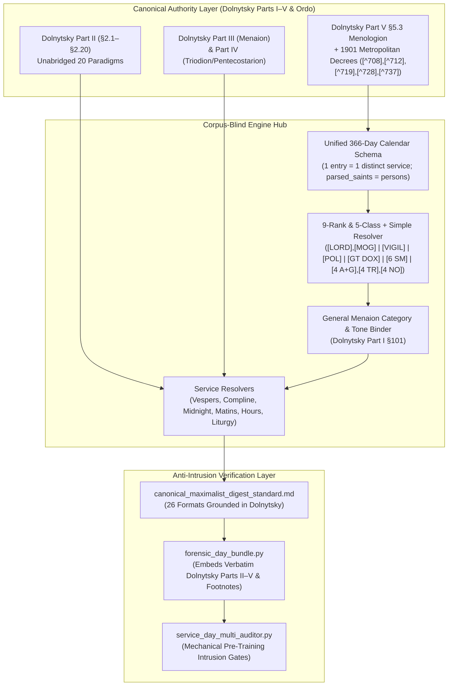

# Systemic Calendar, Rubric & Pre-Training Intrusion Architecture Plan

## Goal Description

During Days 1–22 (`2026-10-11` through `2026-11-01`) of the Zero-Cache Live-Engine Sequential Forensic Audit (`use_almanac_cache=False`), six systemic classes of recurring defects were identified. These defects stem from:
1. **Multi-layer calendar and Menologion collisions** between [`calendar_typikon.json`](file:///c:/Users/augus/OneDrive/Documents/Google%20Antigravity/Projects/Typikon%20Coded/json_db/calendar_typikon.json), [`calendar_ugcc_official.json`](file:///c:/Users/augus/OneDrive/Documents/Google%20Antigravity/Projects/Typikon%20Coded/json_db/calendar_ugcc_official.json), and legacy Stamford-derived overrides in `json_db/02b_01_september.json`–`02b_12_august.json`.
2. **LLM Pre-Training Data Intrusion**, where Russian/OCA Synodal *Tserkovnyj Ustav* rules and ancient Sabaitic "no-sign" assumptions contaminated [`02a_logic_general.json`](file:///c:/Users/augus/OneDrive/Documents/Google%20Antigravity/Projects/Typikon%20Coded/json_db/02a_logic_general.json), [`02f_logic_liturgy.json`](file:///c:/Users/augus/OneDrive/Documents/Google%20Antigravity/Projects/Typikon%20Coded/json_db/02f_logic_liturgy.json), [`canonical_maximalist_digest_standard.md`](file:///c:/Users/augus/OneDrive/Documents/Google%20Antigravity/Projects/Typikon%20Coded/.agents/references/canonical_maximalist_digest_standard.md), [`digest/formatters/vespers.py`](file:///c:/Users/augus/OneDrive/Documents/Google%20Antigravity/Projects/Typikon%20Coded/digest/formatters/vespers.py), and [`digest/formatters/matins.py`](file:///c:/Users/augus/OneDrive/Documents/Google%20Antigravity/Projects/Typikon%20Coded/digest/formatters/matins.py).
3. **Coupling of rubrical resolution to incomplete text corpora**, where the engine allowed missing keys or legacy Stamford 2014 compilation artifacts to alter canonical Dolnytsky rubrical structure.

This plan establishes a clean, corpus-blind, source-grounded architecture across all 366 days of the liturgical year so that the live sequential audit can resume from `2026-11-01` with zero recurring structural drift.

---

## Locked Architectural Decisions (Initial Interview + 6-Part `/grill-me` Deep Dive)

> [!IMPORTANT]
> **1. Unified Calendar Authority (`calendar_typikon.json`) & the 9 Calendar Diffs**
> - A single unified 366-day schema in [`calendar_typikon.json`](file:///c:/Users/augus/OneDrive/Documents/Google%20Antigravity/Projects/Typikon%20Coded/json_db/calendar_typikon.json) replaces the drifting dual-JSON setup (`calendar_typikon.json` vs. `calendar_ugcc_official.json`).
> - **`9-26` Translation Fix**: Fix the mistranslation of Slavonic *Преставленіє* from `"Translation"` to `"Repose / Falling Asleep of the Holy Apostle and Evangelist John the Theologian"` universally (matching Dolnytsky Part III §3.1.9 line 2134).
> - **Default vs. `lviv_1899` Profile Tags on the 9 Calendar Diffs**:
>   - In the default profile, resolve the 9 diffs (`5-11` Cyril & Methodius, `7-5` Athanasius of Athos, `7-6` Sisoes, `7-11` Olga `[POL]`, and no weekday-to-Sunday transfer of the 5 Vigil feasts `4-23`, `7-20`, `8-29`, `9-26`, `11-12`) to modern UGCC Synodal practice, while preserving the 1899 Lviv Synod variants under an explicit `"lviv_1899"` profile tag inside `calendar_typikon.json`.

> [!IMPORTANT]
> **2. `entries` = Distinct Liturgical Services (1 or 2) vs. `parsed_saints` = Individual Commemorated Persons**
> - Normalize all 366 days in [`calendar_typikon.json`](file:///c:/Users/augus/OneDrive/Documents/Google%20Antigravity/Projects/Typikon%20Coded/json_db/calendar_typikon.json) so that `entries` strictly represents **distinct Menaion services** (1 or 2 per day per Dolnytsky II:913 `[^45]`).
> - Split true 2-service days that were previously merged into 1 entry (`10-15`, `10-17`, `10-19`, `10-22`, `11-20`, `12-15`, `2-8`, `4-29`, `7-19`, etc.) into 2 distinct `entries`, and delete the hardcoded 6-date `split_two_saints_keys` hack in [`engine/calendar.py:794`](file:///c:/Users/augus/OneDrive/Documents/Google%20Antigravity/Projects/Typikon%20Coded/engine/calendar.py#L794).
> - On shared-service group days (1 `entry` with multiple `parsed_saints`, e.g., `11-1` *Physicians and Unmercenaries Cosmas and Damian*, `11-2` *Martyrs Akindynos, Pegasius, Aphthonius, Elpidephorus and Anempodistus*, `11-5` *Martyrs Galaction and Episteme*), use the entry's full group description for `saints[i]["name"]` while preserving `parsed_saints` for the Dismissal commemoration list.

> [!IMPORTANT]
> **3. Corpus-Blind Hub & Scoping `02b_01_september.json`–`02b_12_august.json` Strictly to Dolnytsky Part III**
> - Text compilations (2014 Stamford or Royal Doors) are variable text Spokes and **never** govern rubrical decisions.
> - Scope `json_db/02b_01_september.json`–`02b_12_august.json` strictly to **Dolnytsky Part III (`§3.1`–`§3.12`)** special date rubrics and scripture pericopes.
> - Prune redundant Part II stubs (`10-28`, `6-09`, `6-10`, etc.) and fix all **15 rank mismatches** (`9-1`, `9-6`, `9-9`, `9-13`, `11-15`, `11-24`, `12-4`, `12-26`, `12-27`, `1-7`, `1-22`, `4-1`, `5-7`, `8-1`, `8-16`) to match Dolnytsky Part V §5.3 & Part III.

> [!IMPORTANT]
> **4. The 5 Festal Classes + Simple vs. 9 Dolnytsky Ranks (`ssjc.uk` Alignment)**
> - Distinguish **Solemnity Class** (5 Festal Classes + Simple) from **Dolnytsky Rank Code** ($2 + 1 + 1 + 1 + 1 + 3 = 9$) across [`engine/calendar.py`](file:///c:/Users/augus/OneDrive/Documents/Google%20Antigravity/Projects/Typikon%20Coded/engine/calendar.py) and [`Data/prototypes/cantor_dashboard/main.js`](file:///c:/Users/augus/OneDrive/Documents/Google%20Antigravity/Projects/Typikon%20Coded/Data/prototypes/cantor_dashboard/main.js):
>   - **Class I — Great Feast**: `[LORD]`, `[MOG]` (top 2 ranks)
>   - **Class II — Vigil**: `[VIGIL]`
>   - **Class III — Polyeleos**: `[POL]`
>   - **Class IV — Great Doxology**: `[GT DOX]`
>   - **Class V — Six-Stichera**: `[6 SM]`
>   - **Simple (Class VI / Unclassed — Simple)**: `[4 A+G]`, `[4 TR]`, `[4 NO]` (bottom 3 ranks)

> [!CAUTION]
> **5. Elimination of the False `[4 NO]` ("No Troparion") Pre-Training Conflation**
> - Per [`Dolnytsky_Typikon_Master.md`](file:///c:/Users/augus/OneDrive/Documents/Google%20Antigravity/Projects/Typikon%20Coded/Data/Service%20Books/Typikon/Dolnytsky_Typikon_Master.md) **Part II Footnote `[^45]` (line 13670)** and **Part V Footnote `[^699]` (line 14324, Sept 10)**:
>   - Dolnytsky explicitly decrees: *"But in our current Horologia, troparia are given for every day of the month, and therefore at Matins we always sing 'God is the Lord,' and we limit the 'Alleluia' service to Great Lent, as do the Greeks"* (`[^45]`) and *"Thus we present according to ancient rubrics; according to the new — in our Horologia troparia to saints are added for all days"* (`[^699]`).
>   - Delete the false `is_no_troparion` (`[4 NO]`) weekday-troparion substitution in [`digest/formatters/vespers.py:428-449`](file:///c:/Users/augus/OneDrive/Documents/Google%20Antigravity/Projects/Typikon%20Coded/digest/formatters/vespers.py#L428-L449) and [`digest/formatters/matins.py:607-635`](file:///c:/Users/augus/OneDrive/Documents/Google%20Antigravity/Projects/Typikon%20Coded/digest/formatters/matins.py#L607-L635).

> [!IMPORTANT]
> **6. Divine Liturgy Combination Rules (`§2.1` lines 991–994 & `[^69]` vs. `§2.2` lines 1062–1065 & `[^91]`)**
> - **Weekdays & Saturdays (`§2.2` lines 1062–1065, `§2.3` line 1125)**: Follow Dolnytsky's Combined Menologion Rubric (Day + Saint Troparion/Kontakion; 2 reading sets when the Saint is `[4 A+G]`, `[6 SM]`, `[GT DOX]`, `[POL]`, or `[VIGIL]`; 1 sequential reading set when `[4 TR]` or `[4 NO]`).
> - **Sundays (`§2.1` lines 991–994, Footnote `[^69]`, and `§3.1.8` line 2132)**: Include the Saint's Liturgy propers (Troparion, Kontakion, Prokimenon, Alleluia, Epistle/Gospel reading set, and Communion Hymn) on Sundays when the Saint is **`[GT DOX]`, `[POL]`, or `[VIGIL]`**, while keeping Saints below `[GT DOX]` (`[6 SM]`, `[4 A+G]`, `[4 TR]`, `[4 NO]`) to **Sunday-only Liturgy** (Resurrectional Troparion, Resurrectional Kontakion, 1st/Festal Theotokion or *"O Protection of Christians"*, and 1 Sunday reading set) per Dolnytsky `§2.1` lines 991–994 and Footnote `[^69]`.

> [!IMPORTANT]
> **7. `[6 SM]` Sub-Variants (`§2.2` Notes 1–4) & 1901 Metropolitan Ordinariate Decrees (`[^708]`, `[^712]`, `[^719]`, `[^728]`, `[^737]`)**
> - Apply the 1901 Lviv Metropolitan Ordinariate decrees in the default profile (while preserving 1899 base tags under `"lviv_1899"`):
>   - Elevate `11-1` Cosmas & Damian (`[^708]`), `12-4` Great Martyr Barbara (`[^719]`), `12-27` Protomartyr Stephen (`[^728]`), and `6-12` Ven. Onuphrius (`[^737]`) from `[6 SM]` to **`[GT DOX]`**.
>   - Omit the second service (`Barlaam and Josaphat`) on `11-19` (`[^712]`, leaving Prophet Obadiah and Martyr Barlaam).
> - Encode explicit `[6 SM]` sub-variant capability flags in `calendar_typikon.json` per Dolnytsky `§2.2` Notes 2–3 (lines 1043–1045):
>   - `has_matins_aposticha_sticheron: true` on `11-17` (St. Gregory the Wonderworker, `§2.2` Note 2).
>   - `has_praises_stichera_small_doxology: true` on `9-6` (Miracle of Archangel Michael) and `10-7` (Martyrs Sergius & Bacchus, `§2.2` Note 3).

> [!IMPORTANT]
> **8. Temple Patron Slots at the Hours vs. Divine Liturgy (`Dolnytsky [^89], [^91]` vs. Moscow Typikon Intrusion)**
> - **At the Canonical Hours (`§2.1` lines 984–985, `§2.2` lines 1050–1051, `§2.3` lines 1119–1120) and Compline (`§2.2` line 1019)**: Preserve the canonical `"Troparion / Kontakion of the Temple"` slots (including fixing `hours.py:145-150` on ordinary Sundays so `Glory: Troparion of the Temple` is prescribed at both the **1st and 6th Hours** per `§2.1` line 984).
> - **At Divine Liturgy (`§2.1` line 991, `§2.2` line 1055, Footnotes `[^89]`, `[^91]`)**: Purge the Moscow Typikon `temple` Troparion and Kontakion from `sunday_saint_temple` and `weekday_saint_temple` in [`json_db/02f_logic_liturgy.json`](file:///c:/Users/augus/OneDrive/Documents/Google%20Antigravity/Projects/Typikon%20Coded/json_db/02f_logic_liturgy.json#L128-L250). Per Dolnytsky `[^89]` and `[^91]`, Temple Troparia/Kontakia at Divine Liturgy are only taken when the Temple is dedicated to the Lord or the Theotokos; baseline parish-agnostic digests default to `"O Protection of Christians"` (*Steadfast Protectress*).

---

## Architecture Diagram



---

## Proposed Changes

### Component 1: Unified Calendar Schema, Service-vs-Person Normalization & Scoping `02b_*.json` to Part III

#### [MODIFY] [calendar_typikon.json](file:///c:/Users/augus/OneDrive/Documents/Google%20Antigravity/Projects/Typikon%20Coded/json_db/calendar_typikon.json)
* Audit all 366 days against [`Dolnytsky_Typikon_Master.md`](file:///c:/Users/augus/OneDrive/Documents/Google%20Antigravity/Projects/Typikon%20Coded/Data/Service%20Books/Typikon/Dolnytsky_Typikon_Master.md) Part V §5.3.1–§5.3.12 (lines 9819–10220), Footnotes `[^698]`–`[^786]`, and Part III (§3.1–§3.12).
* Enforce **1 `entry` = 1 distinct liturgical service** (1 or 2 per day) and **`parsed_saints` = individual commemorated persons**:
  * Split all 2-service days that were previously combined into a single `entry` (`10-15`, `10-17`, `10-19`, `10-22`, `11-20`, `12-15`, `2-8`, `4-29`, `7-19`, etc.) into 2 separate `entries`.
  * Keep shared-service group commemorations (`11-1` Cosmas & Damian, `11-2` Akindynos et al., `11-5` Galaction & Episteme, etc.) as 1 `entry` with multiple `parsed_saints`.
* Fix `9-26` English description to `"Repose of the Holy Apostle and Evangelist John the Theologian"`.
* Encode the 9 UGCC Synodal diffs (`5-11`, `7-5`, `7-6`, `7-11`, and the 5 Vigil Sunday-transfer flags `4-23`, `7-20`, `8-29`, `9-26`, `11-12`) and the 5 1901 Metropolitan Ordinariate footnote decrees (`11-1` `[^708]`, `11-19` `[^712]`, `12-4` `[^719]`, `12-27` `[^728]`, `6-12` `[^737]`) as default with `"lviv_1899"` historical tags.
* Attach explicit capability flags (`has_lord_i_call_doxastikon`, `has_aposticha_doxastikon`, `has_praises_stichera_small_doxology`, `has_matins_aposticha_sticheron`, `category`, `default_troparion_tone`) to each service entry.

#### [MODIFY] [core.py](file:///c:/Users/augus/OneDrive/Documents/Google%20Antigravity/Projects/Typikon%20Coded/engine/core.py) & [calendar.py](file:///c:/Users/augus/OneDrive/Documents/Google%20Antigravity/Projects/Typikon%20Coded/engine/calendar.py)
* In `engine/core.py:198-212`: Load `json_db/calendar_typikon.json` as the single unified calendar source, applying `"lviv_1899"` tags only when `version_id == "lviv_1899"`.
* In `engine/calendar.py:785-861` (`_lookup_dolnytsky_calendar`):
  * Delete the hardcoded `split_two_saints_keys` tuple.
  * Construct `saints_list` directly from `entries` (1 entry = 1 service in `context["saints"]`).
  * When an entry has `len(parsed_saints) > 1` (a shared-service group like `11-1` Cosmas & Damian or `11-2` Akindynos et al.), set `saint["name"]` to the entry's full group description (stripped of rank prefix) while storing individual names in `all_parsed_saints` for the Dismissal.

#### [MODIFY] [rubrics.py](file:///c:/Users/augus/OneDrive/Documents/Google%20Antigravity/Projects/Typikon%20Coded/engine/rubrics.py) & `json_db/02b_01_september.json`–`02b_12_august.json`
* Scope `02b_01_september.json`–`02b_12_august.json` strictly to Dolnytsky Part III (`§3.1`–`§3.12`) special date rubrics and scripture pericopes; prune redundant Part II stubs (`10-28`, `6-09`, `6-10`, etc.) and fix all 15 rank mismatches (`9-1`, `9-6`, `9-9`, `9-13`, `11-15`, `11-24`, `12-4`, `12-26`, `12-27`, `1-7`, `1-22`, `4-1`, `5-7`, `8-1`, `8-16`).
* In `engine/rubrics.py:1413-1520`: Prevent `menaion_day.get("title_key")` from overwriting `context["saints"][0]["id"]` on multi-saint or group-saint days.

---

### Component 2: Dolnytsky Part II Unabridged Logic (`02a_logic_general.json`, `02f_logic_liturgy.json`) & Overhaul of `canonical_maximalist_digest_standard.md`

#### [MODIFY] [02a_logic_general.json](file:///c:/Users/augus/OneDrive/Documents/Google%20Antigravity/Projects/Typikon%20Coded/json_db/02a_logic_general.json) & [02f_logic_liturgy.json](file:///c:/Users/augus/OneDrive/Documents/Google%20Antigravity/Projects/Typikon%20Coded/json_db/02f_logic_liturgy.json)
* Audit `CASE_01` through `CASE_20` against `Dolnytsky_Typikon_Master.md` Part II (`§2.1`–`§2.20`, lines 905–2050):
  * **`CASE_01` (§2.1 Sunday + Saint without Polyeleos)**:
    * Add missing `"saint_on_6_doxology"` and `"saint_on_6"` branches in `matins_canon_distribution`: `4 Resurrection (with Irmos) + 2 Cross-Resurrection + 2 Theotokos + 6 Saint` = 14 (Dolnytsky II:972).
    * Align `vespers_stichera_distribution` (`7+3` for 1 saint, `4+3+3` for 2 saints, `6+4` for saint on 6 per Dolnytsky II:924–927) and `praises_distribution` (`8 Octoechos` unless `has_praises_stichera` or `[GT DOX]`, which takes `4 Octoechos + 4 Saint` per Dolnytsky II:973–975).
    * Align Sunday `liturgy_variables` and `02f_logic_liturgy.json`: on Sundays with a Saint below `[GT DOX]` (`[6 SM]`, `[4 A+G]`, `[4 TR]`, `[4 NO]`), prescribe Sunday-only Liturgy (Resurrectional Troparion; `Glory:` Resurrectional Kontakion; `Both now:` Theotokion / *"O Protection of Christians"*; 1 Sunday reading set) per Dolnytsky II:991–994 & `[^69]`; on Sundays with `[GT DOX]`, `[POL]`, or `[VIGIL]`, include the Saint's Troparion, Kontakion, Prokimenon/Alleluia, 2nd reading set, and Communion Hymn per Dolnytsky II:1169–1170 & III:2132.
  * **Purge Moscow Typikon Temple-of-a-Saint Liturgy Intrusion (`02f_logic_liturgy.json:128-250`)**:
    * Remove `"source": "temple"` Troparion and Kontakion from `sunday_saint_temple` and `weekday_saint_temple` per Dolnytsky II:991, 1055 and Footnotes `[^89]`, `[^91]`.

#### [MODIFY] [common.py](file:///c:/Users/augus/OneDrive/Documents/Google%20Antigravity/Projects/Typikon%20Coded/engine/resolvers/common.py) & [liturgy.py](file:///c:/Users/augus/OneDrive/Documents/Google%20Antigravity/Projects/Typikon%20Coded/engine/resolvers/liturgy.py)
* Unify `resolve_canon_structure` (`common.py:388-401`) and `resolve_canon_stack` (`common.py:681-698`) switch-key selection (`"2_saints"`, `"saint_on_6_doxology"`, `"saint_on_6"`, `"1_saint"`).
* In `engine/resolvers/liturgy.py` and `digest/formatters/liturgy.py`: Enforce the Sunday Liturgy gate (`[GT DOX]`, `[POL]`, `[VIGIL]` include Saint propers/readings; `[6 SM]`, `[4 A+G]`, `[4 TR]`, `[4 NO]` take Sunday-only Liturgy per `§2.1` lines 991–994 & `[^69]`) and the Weekday/Saturday Combined Menologion gate (`[4 A+G]`, `[6 SM]`, `[GT DOX]`, `[POL]`, `[VIGIL]` take 2 reading sets; `[4 TR]` and `[4 NO]` take Day + Saint Troparion/Kontakion with 1 sequential reading set per `§2.2` lines 1057, 1062).

#### [MODIFY] [canonical_maximalist_digest_standard.md](file:///c:/Users/augus/OneDrive/Documents/Google%20Antigravity/Projects/Typikon%20Coded/.agents/references/canonical_maximalist_digest_standard.md)
* Rewrite all 26 formats (`FORMAT 01`–`FORMAT 26`) against `Dolnytsky_Typikon_Master.md` Parts II–V, purging all Russian/OCA Typikon ratios (`FORMAT 01` `4+3+3+4`; `FORMAT 02` `6+4+4`; `FORMAT 04` `6+4+4`; `FORMAT 05` `[6 SM]` vs `[GT DOX]`; `FORMAT 06` `4+4+6` plus Notes 2–3 sub-variants; `FORMAT 17–18` Saturday Menaion-first Vespers and Small Doxology).

---

### Component 3: 5 Festal Classes + Simple vs. 9 Dolnytsky Ranks (`ssjc.uk` Standard), Hours Fixes & Purge of False `[4 NO]` Suppression

#### [MODIFY] [calendar.py](file:///c:/Users/augus/OneDrive/Documents/Google%20Antigravity/Projects/Typikon%20Coded/engine/calendar.py) & [main.js](file:///c:/Users/augus/OneDrive/Documents/Google%20Antigravity/Projects/Typikon%20Coded/Data/prototypes/cantor_dashboard/main.js)
* Expose both `dolnytsky_rank_code` (9 ranks) and `menaion_class` (`Class I`–`Class V` + `Simple`) in `engine/calendar.py` and `Data/prototypes/cantor_dashboard/main.js`.

#### [MODIFY] [common.py](file:///c:/Users/augus/OneDrive/Documents/Google%20Antigravity/Projects/Typikon%20Coded/engine/resolvers/common.py), [matins.py](file:///c:/Users/augus/OneDrive/Documents/Google%20Antigravity/Projects/Typikon%20Coded/engine/resolvers/matins.py), [hours.py](file:///c:/Users/augus/OneDrive/Documents/Google%20Antigravity/Projects/Typikon%20Coded/engine/resolvers/hours.py)
* In `engine/resolvers/common.py:547` (`resolve_canon_interludes`): Prescribe the Saint's Kontakion/Ikos and Sessional Hymn after Ode 3 on ANY Sunday with a commemorated saint (`if saints:`, Dolnytsky II:966, 971).
* In `engine/resolvers/matins.py`: Prescribe the Saint's Exapostilarion after Ode 9 whenever appointed on Sunday (`Dolnytsky II:970–971`), and support `[6 SM]` sub-variants (`11-17` Matins Aposticha Sticheron + Doxastikon per `§2.2` Note 2; `9-6` & `10-7` 4 Praises Stichera + Small Doxology per `§2.2` Note 3).
* In `engine/resolvers/hours.py:145-155`: Fix ordinary Sunday 1st Hour Troparion to include `Glory: Troparion of the Temple` (`["trop_resurrection", "glory", "trop_temple"]`) at both the 1st and 6th Hours (for 1 saint) per Dolnytsky `§2.1` line 984, and `1st & 3rd—first saint, 6th—Temple, 9th—second saint` (for 2 saints) per `§2.1` line 985 & `[^65]`.

#### [MODIFY] [vespers.py (formatter)](file:///c:/Users/augus/OneDrive/Documents/Google%20Antigravity/Projects/Typikon%20Coded/digest/formatters/vespers.py) & [matins.py (formatter)](file:///c:/Users/augus/OneDrive/Documents/Google%20Antigravity/Projects/Typikon%20Coded/digest/formatters/matins.py)
* Delete the false `is_no_troparion` (`[4 NO]`) weekday-troparion substitution in `digest/formatters/vespers.py:428-449` and `digest/formatters/matins.py:607-635` per Dolnytsky `[^45]` and `[^699]`.

---

### Component 4: Corpus-Blind `"If Appointed"` Resolution & Formatter Filter Cleanup

#### [MODIFY] [vespers.py](file:///c:/Users/augus/OneDrive/Documents/Google%20Antigravity/Projects/Typikon%20Coded/engine/resolvers/vespers.py) & [common.py (formatter)](file:///c:/Users/augus/OneDrive/Documents/Google%20Antigravity/Projects/Typikon%20Coded/digest/formatters/common.py)
* Refactor `_saint_has_appointed_doxastikon(self, saint, context, slot="lord_i_call")` in `engine/resolvers/vespers.py` to use slot-specific (`"lord_i_call"` vs. `"aposticha"`), corpus-blind capability checks from `calendar_typikon.json` and Dolnytsky's rank rules.
* Emit `"id": "saint_doxastikon"` when confirmed, and remove the destructive `if "if_appointed" in ...: has_glory = False` filter in `digest/formatters/common.py:230`.

---

### Component 5: Dismissal Theotokion Tone & General Menaion Tone Binding (`Dolnytsky Part I §101`)

#### [MODIFY] [calendar.py](file:///c:/Users/augus/OneDrive/Documents/Google%20Antigravity/Projects/Typikon%20Coded/engine/calendar.py), [vespers.py](file:///c:/Users/augus/OneDrive/Documents/Google%20Antigravity/Projects/Typikon%20Coded/engine/resolvers/vespers.py), [matins.py](file:///c:/Users/augus/OneDrive/Documents/Google%20Antigravity/Projects/Typikon%20Coded/engine/resolvers/matins.py), [vespers.py (formatter)](file:///c:/Users/augus/OneDrive/Documents/Google%20Antigravity/Projects/Typikon%20Coded/digest/formatters/vespers.py), [matins.py (formatter)](file:///c:/Users/augus/OneDrive/Documents/Google%20Antigravity/Projects/Typikon%20Coded/digest/formatters/matins.py)
* Bind `saint["troparion_tone"]` from the canonical General Menaion Category Tone Map whenever a saint lacks a proper Troparion tone.
* Bind every Dismissal Theotokion (`Both now` at Vespers Troparia, Matins *God is the Lord*, and Matins Dismissal) to the tone of the immediately preceding `Glory` Troparion (`saints[-1]["troparion_tone"]` for 2 saints; `saints[0]["troparion_tone"]` for 1 saint).
* Explicitly format both Series and Tone (`"Resurrectional Dismissal Theotokion in Tone [Roman]"` vs. `"Weekday Dismissal Theotokion of [Day] in Tone [Roman]"`).

---

### Component 6: Synodal Footnotes Classification & Anti-Pre-Training Vaccination in `forensic_day_bundle.py`

#### [MODIFY] [synodal_footnotes.json](file:///c:/Users/augus/OneDrive/Documents/Google%20Antigravity/Projects/Typikon%20Coded/json_db/synodal_footnotes.json), [forensic_day_bundle.py](file:///c:/Users/augus/OneDrive/Documents/Google%20Antigravity/Projects/Typikon%20Coded/scripts/forensic_day_bundle.py), [service_day_multi_auditor.py](file:///c:/Users/augus/OneDrive/Documents/Google%20Antigravity/Projects/Typikon%20Coded/scripts/service_day_multi_auditor.py)
* Classify footnotes in `synodal_footnotes.json` into `"EXECUTABLE_RUBRIC"` vs. `"SCHOLARLY_NOTE"`.
* Upgrade `scripts/forensic_day_bundle.py` to embed the verbatim Dolnytsky Part II (`§2.1`–`§2.20`), Part III (`§3.1`–`§3.12`), Part IV, and Part V (`§5.3`) sections and footnotes directly into each day's forensic bundle.
* Add deterministic Anti-Pre-Training Intrusion Gates to `scripts/service_day_multi_auditor.py`.

---

## Verification Plan

### Automated Tests
1. **Session Compliance Gate**:
   ```powershell
   $env:PYTHONPATH="." ; $env:PAGER="cat" ; .venv\Scripts\python.exe -m pytest tests/test_session_compliance.py --verbose
   ```
2. **New Systemic Architecture & Anti-Intrusion Test Suite (`tests/test_systemic_dolnytsky_architecture.py`)**:
   * Verifies 366-day parity between `calendar_typikon.json` and `Dolnytsky_Typikon_Master.md` §5.3 (including the 9 UGCC Synodal diffs, the 1901 Metropolitan Ordinariate decrees `[^708]`, `[^712]`, `[^719]`, `[^728]`, `[^737]`, and 2-service splitting).
   * Verifies `Class I`–`Class V` + `Simple` vs. 9-Rank mapping.
   * Verifies `[4 NO]` saints outside Great Lent always resolve Saint Troparion & Kontakion (`[^45]`, `[^699]`).
   * Verifies Sunday vs. Weekday Divine Liturgy combination rules (`§2.1` lines 991–994 & `[^69]` vs. `§2.2` lines 1062–1065 & `[^91]`) and absence of Moscow Typikon Temple-of-a-Saint Liturgy intrusions (`[^89]`, `[^91]`).
   * Verifies Days 1–22 (`2026-10-11` through `2026-11-01`) pass `ServiceDayMultiAuditor` and `DayCardsAuditor`.
3. **Full Test Suite & Database Linter**:
   ```powershell
   $env:PYTHONPATH="." ; $env:PAGER="cat" ; .venv\Scripts\python.exe -m pytest --ignore=tests/test_ui_readability.py --verbose
   $env:PYTHONPATH="." ; .venv\Scripts\python.exe scripts/lint_liturgical_db.py
   ```
