# Comprehensive Remediation Plan: Eradicating Potemkin Goodharting (`SGC-01`..`SGC-04`) in `Typikon Coded` & Hardening Ecosystem Verification

## Locked-In Design Decisions (From `/grill-me` Alignment)

All 6 architectural branches have been resolved and locked in:

1. **Branch 1 — Jurisdictional & Execution Scope**: Execute **Phases 1–5** inside `Typikon Coded` and `Shared_Lexicon/atomic_corpus/`, followed by **Phase 6** upgrading the Parent Hub's [`../scripts/verify_ecosystem_integrity.py`](file:///c:/Users/augus/OneDrive/Documents/Google%20Antigravity/Projects/scripts/verify_ecosystem_integrity.py), [`../SPOKE_SYNCHRONIZATION_PROMPT.md`](file:///c:/Users/augus/OneDrive/Documents/Google%20Antigravity/Projects/SPOKE_SYNCHRONIZATION_PROMPT.md), [`../GLOBAL_SYSTEM_RULES.md` §8](file:///c:/Users/augus/OneDrive/Documents/Google%20Antigravity/Projects/GLOBAL_SYSTEM_RULES.md#L121-L163), and regenerating [`../reports/ecosystem_integrity_census.md`](file:///c:/Users/augus/OneDrive/Documents/Google%20Antigravity/Projects/reports/ecosystem_integrity_census.md).
2. **Branch 2 — Service Booklet Compilation Architecture**: Refactor [`engine/service_book_compiler.py`](file:///c:/Users/augus/OneDrive/Documents/Google%20Antigravity/Projects/Typikon%20Coded/engine/service_book_compiler.py) to eliminate all 560 lines of hardcoded `md.append(...)` prose and actively consume `self.struct_vespers` (`01h_struct_vespers.json`), `04_logic_vespers.json`, `02a_logic_general.json`, and `service_book_partitions.json`, resolve fixed prayers/psalms dynamically from `TextDB` / `atomic_corpus`, and slice verbatim Ordo (`§29–§73`) and Dolnytsky (Part I) rubrics directly from `Ordo_Celebrationis_1996_CLEAN.md` and `Dolnytsky_Typikon_Master.md` at compile time.
3. **Branch 3 — 4-Shard Shared Atomic Corpus Hydration & `TextDB` Wiring**: Deterministically match canonical Hub primitives against verbatim `TEXT_LINES` slices in `HOROLOGION.txt`, `OCTOECHOS.txt`, `COMMON OF THE SAINTS.txt`, and `MENAION.txt` (plus `Master_Incipits.json`), populate all 4 shards in [`../Shared_Lexicon/atomic_corpus/`](file:///c:/Users/augus/OneDrive/Documents/Google%20Antigravity/Projects/Shared_Lexicon/atomic_corpus/master_liturgical_corpus.json) via [`atomic_corpus_resolver.py`](file:///c:/Users/augus/OneDrive/Documents/Google%20Antigravity/Projects/Shared_Lexicon/atomic_corpus_resolver.py), wire [`engine/core.py`](file:///c:/Users/augus/OneDrive/Documents/Google%20Antigravity/Projects/Typikon%20Coded/engine/core.py) and [`engine/text_db.py`](file:///c:/Users/augus/OneDrive/Documents/Google%20Antigravity/Projects/Typikon%20Coded/engine/text_db.py) to query `master_liturgical_corpus.json` first, and enforce `total_entries_verified > 0` in Gate 4.
4. **Branch 4 — Spoke Supply-Chain Sanitization & Hub Inbox Gatekeeper**: Stamp empty/truncated/boilerplate fields in [`festal_propers_pure_typikon_database.json`](file:///c:/Users/augus/OneDrive/Documents/Google%20Antigravity/Projects/Typikon%20Coded/json_db/propers_comparisons/festal_propers_pure_typikon_database.json) and [`Data/yas_no_*_parsed.json`](file:///c:/Users/augus/OneDrive/Documents/Google%20Antigravity/Projects/Typikon%20Coded/Data/yas_no_14_parsed.json) with `"CORPUS_GAP_UNVERIFIED_PRIMARY_SOURCE"`, fix Ode/Genre title contradictions, upgrade [`tests/test_musicology_ingestion.py`](file:///c:/Users/augus/OneDrive/Documents/Google%20Antigravity/Projects/Typikon%20Coded/tests/test_musicology_ingestion.py), and deploy `scripts/audit_inbox_handoffs.py` to block promoting `Data/Inbox/` payloads from spokes with active Gate 3 violations.
5. **Branch 5 — Bijective Citation & Grounding Matrix Strictness**: Re-anchor all `@liturgical_source` decorators in `engine/` to exact current line ranges and section IDs in `Dolnytsky_Typikon_Master.md` and `Ordo_Celebrationis_1996_CLEAN.md`, deterministically regenerate [`docs/encyclopedia/master_citation_matrix.md`](file:///c:/Users/augus/OneDrive/Documents/Google%20Antigravity/Projects/Typikon%20Coded/docs/encyclopedia/master_citation_matrix.md) from verbatim source slices, and enforce runtime file/section/line verification in [`tests/test_source_grounding.py`](file:///c:/Users/augus/OneDrive/Documents/Google%20Antigravity/Projects/Typikon%20Coded/tests/test_source_grounding.py) and [`scripts/audit_citations.py`](file:///c:/Users/augus/OneDrive/Documents/Google%20Antigravity/Projects/Typikon%20Coded/scripts/audit_citations.py).
6. **Branch 6 — 5-Point Parent Hub AST Hardening & Artifact Lineage Law**: Upgrade [`../scripts/verify_ecosystem_integrity.py`](file:///c:/Users/augus/OneDrive/Documents/Google%20Antigravity/Projects/scripts/verify_ecosystem_integrity.py) with `*_compiler.py`/`*_synthesizer.py`/`audit_*.py` matching, cumulative atomized prose detection ($\ge 1,200$ chars across $\ge 10$ `.append()`/`.write()` calls), class `self.<attr> = json.load()` dead-loader detection, Gate 2 local-dict false-positive fix, and Gate 4 `total_entries_verified > 0` enforcement; codify the **"No Crime-Scene Cleanup" Artifact Lineage Law** in [`../SPOKE_SYNCHRONIZATION_PROMPT.md`](file:///c:/Users/augus/OneDrive/Documents/Google%20Antigravity/Projects/SPOKE_SYNCHRONIZATION_PROMPT.md) and [`../GLOBAL_SYSTEM_RULES.md` §8](file:///c:/Users/augus/OneDrive/Documents/Google%20Antigravity/Projects/GLOBAL_SYSTEM_RULES.md#L121-L163).

---

## Architecture & Remediation Workflow

```mermaid
flowchart TD
    subgraph P1["Phase 1: Gate 2/3 & Legacy Hygiene"]
        A1["Archive DeepSeek & Potemkin scripts to scripts/archived_pipelines/"]
        A2["Fix chronicle_harvester.py dynamic paths & local dict naming"]
        A3["Upgrade verify_semantics.py & verify_sliding_window.py to SGC-02"]
        A4["Fix MyFirstGui paths in validate_db.py, verify_propers_addressability.py & verify_function_coverage.py"]
    end

    subgraph P2["Phase 2: True Data-Driven Service Booklet Compiler"]
        B1["Refactor engine/service_book_compiler.py: traverse 01h_struct_vespers.json + TextDB + slice Ordo/Dolnytsky"]
        B2["Recompile docs/service_books/01_great_vespers_canonical.md (0 hardcoded prose)"]
        B3["Upgrade scripts/audit_service_booklet.py to open Ordo, Dolnytsky & Horologion JSON at runtime"]
    end

    subgraph P3["Phase 3: SGC-02 Citation & Source-Grounding Verification"]
        C1["Re-anchor @liturgical_source decorators in engine/ to exact Dolnytsky/Ordo line ranges"]
        C2["Deterministically regenerate docs/encyclopedia/master_citation_matrix.md from verbatim slices"]
        C3["Upgrade scripts/audit_citations.py, tests/test_citations.py & tests/test_source_grounding.py"]
    end

    subgraph P4["Phase 4: 4-Shard Atomic Corpus Hydration & Engine Wiring"]
        D1["Register verbatim Stamford Horologion/Octoechos/Menaion primitives across all 4 shards"]
        D2["Wire engine/core.py & engine/text_db.py to query master_liturgical_corpus.json first"]
    end

    subgraph P5["Phase 5: Spoke Payload Sanitization & Inbox Gatekeeper"]
        E1["Run scripts/sanitize_spoke_provenance.py on festal_propers_pure_typikon_database.json & yas_no_*.json"]
        E2["Upgrade tests/test_musicology_ingestion.py & deploy scripts/audit_inbox_handoffs.py"]
    end

    subgraph P6["Phase 6: Parent Hub Auditor & Prompt Hardening"]
        F1["Add 5 AST checks to ../scripts/verify_ecosystem_integrity.py & regenerate census"]
        F2["Codify Potemkin Goodharting Taxonomy & Artifact Lineage Law in SPOKE_SYNCHRONIZATION_PROMPT.md & GLOBAL_SYSTEM_RULES.md"]
    end

    P1 --> P2 --> P3 --> P4 --> P5 --> P6
```



---

## Proposed Changes by Component

### Phase 1: Gate 2/3 Remediation & Legacy Script Hygiene in `Typikon Coded`

#### [ARCHIVE to `scripts/archived_pipelines/`] Legacy Potemkin & DeepSeek Scripts
Move out of active `scripts/` and `scratch/` into `scripts/archived_pipelines/`:
* [`scripts/build_searcher_via_deepseek.py`](file:///c:/Users/augus/OneDrive/Documents/Google%20Antigravity/Projects/Typikon%20Coded/scripts/build_searcher_via_deepseek.py)
* [`scripts/deepseek_analyzer.py`](file:///c:/Users/augus/OneDrive/Documents/Google%20Antigravity/Projects/Typikon%20Coded/scripts/deepseek_analyzer.py), [`scripts/deepseek_compliance_audit.py`](file:///c:/Users/augus/OneDrive/Documents/Google%20Antigravity/Projects/Typikon%20Coded/scripts/deepseek_compliance_audit.py), [`scripts/deepseek_typikon_auditor.py`](file:///c:/Users/augus/OneDrive/Documents/Google%20Antigravity/Projects/Typikon%20Coded/scripts/deepseek_typikon_auditor.py), [`scripts/perfect_plan_via_deepseek.py`](file:///c:/Users/augus/OneDrive/Documents/Google%20Antigravity/Projects/Typikon%20Coded/scripts/perfect_plan_via_deepseek.py), [`scripts/reconcile_failures_via_deepseek.py`](file:///c:/Users/augus/OneDrive/Documents/Google%20Antigravity/Projects/Typikon%20Coded/scripts/reconcile_failures_via_deepseek.py)
* [`scripts/chronicle_synthesizer.py`](file:///c:/Users/augus/OneDrive/Documents/Google%20Antigravity/Projects/Typikon%20Coded/scripts/chronicle_synthesizer.py) (and stamp its output `docs/PROJECT_HISTORY_CHRONICLE.md` or relocate to `scripts/archived_pipelines/`)
* [`scratch/move_parts.py`](file:///c:/Users/augus/OneDrive/Documents/Google%20Antigravity/Projects/Typikon%20Coded/scratch/move_parts.py)
* [`scratch/verify_complex.py`](file:///c:/Users/augus/OneDrive/Documents/Google%20Antigravity/Projects/Typikon%20Coded/scratch/verify_complex.py)

#### [MODIFY] [chronicle_harvester.py](file:///c:/Users/augus/OneDrive/Documents/Google%20Antigravity/Projects/Typikon%20Coded/scripts/chronicle_harvester.py)
* Replace hardcoded `C:\Users\augus\...` paths (`L158–162`) with dynamic `Path(__file__).resolve().parents[1]` / `parents[2]` resolution (Master Rule 10).
* Rename `output_data` (`L172`) to `chronicle_payload` and write to `Data/databases/chronicle_index.json`.

#### [MODIFY] [validate_db.py](file:///c:/Users/augus/OneDrive/Documents/Google%20Antigravity/Projects/Typikon%20Coded/scripts/validate_db.py), [verify_propers_addressability.py](file:///c:/Users/augus/OneDrive/Documents/Google%20Antigravity/Projects/Typikon%20Coded/scripts/verify_propers_addressability.py), & [verify_function_coverage.py](file:///c:/Users/augus/OneDrive/Documents/Google%20Antigravity/Projects/Typikon%20Coded/scripts/verify_function_coverage.py)
* Replace defunct `c:\Users\augus\PycharmProjects\MyFirstGui\json_db` paths with dynamic `PROJECT_ROOT` paths and add `SGC-02` verification against `HOROLOGION.txt` / `OCTOECHOS.txt`.
* Update `verify_function_coverage.py` to parse all `engine/*.py` and `engine/resolvers/*.py` modules via AST rather than reading the 15-line `ruthenian_engine.py` shim.

#### [MODIFY] [verify_semantics.py](file:///c:/Users/augus/OneDrive/Documents/Google%20Antigravity/Projects/Typikon%20Coded/tests/verify_semantics.py) & [verify_sliding_window.py](file:///c:/Users/augus/OneDrive/Documents/Google%20Antigravity/Projects/Typikon%20Coded/tests/verify_sliding_window.py)
* Upgrade both scripts so they dynamically open `json_db/calendar_movable.json`, `json_db/02a_logic_general.json`, and `Data/Service Books/Typikon/Dolnytsky_Typikon_Master.md` at runtime to verify that resolved titles, offsets, and rubric `source_ref` citations exist in the canonical sources (`SGC-02`).

---

### Phase 2: Direct Primary-Source & JSON DB Service Booklet Compiler (`SGC-01a`, `SGC-01b`, `SGC-02`)

#### [MODIFY] [01h_struct_vespers.json](file:///c:/Users/augus/OneDrive/Documents/Google%20Antigravity/Projects/Typikon%20Coded/json_db/01h_struct_vespers.json)
* Enrich the `great_vespers_vigil` sequence and `booklet_metadata` in `json_db/01h_struct_vespers.json` with exact `ordo_paragraphs` (`[29, 30]`, `[31]`, `[32]`, etc.), `dolnytsky_sections` (`1.2.1.1`..`1.2.2.2`), `ptr_tag` identifiers (`[PTR-VESP-01]`..`[PTR-VESP-12]`), and structured Appendix descriptors (`§A`–`§K`) mapped to `04_logic_vespers.json`, `02a_logic_general.json`, and `service_book_partitions.json`.

#### [MODIFY] [service_book_compiler.py](file:///c:/Users/augus/OneDrive/Documents/Google%20Antigravity/Projects/Typikon%20Coded/engine/service_book_compiler.py) & [01_great_vespers_canonical.md](file:///c:/Users/augus/OneDrive/Documents/Google%20Antigravity/Projects/Typikon%20Coded/docs/service_books/01_great_vespers_canonical.md)
* Remove all 560 lines of hardcoded liturgical strings (`L44–604`).
* Implement genuine primary-source and JSON DB compilation:
  1. Traverse `self.struct_vespers["structures"]["great_vespers_vigil"]["sequence"]` (`01h_struct_vespers.json`).
  2. Slice verbatim cited paragraphs (`§29–§73`) from `Data/Service Books/Typikon/Ordo/Ordo_Celebrationis_1996_CLEAN.md` and (`1.2.1.1`–`1.2.2.2`) from `Data/Service Books/Typikon/Dolnytsky_Typikon_Master.md` at compile time.
  3. Resolve fixed liturgical texts (`horologion.vespers.psalm_103`, `great_litany`, `psalm_140`, `psalm_141`, `psalm_129`, `psalm_116`, `fervent_litany`, `vouchsafe_o_lord`, `supplication_litany`, `nunc_dimittis`, `trisagion_block`) dynamically through `RuthenianEngine` (`TextDB` / `atomic_corpus`).
  4. Render Appendices `§A`–`§K` dynamically from `02a_logic_general.json`, `04_logic_vespers.json`, and `service_book_partitions.json`.
* Recompile `docs/service_books/01_great_vespers_canonical.md`.

#### [MODIFY] [audit_service_booklet.py](file:///c:/Users/augus/OneDrive/Documents/Google%20Antigravity/Projects/Typikon%20Coded/scripts/audit_service_booklet.py) & [test_service_book_compilation_and_audit.py](file:///c:/Users/augus/OneDrive/Documents/Google%20Antigravity/Projects/Typikon%20Coded/tests/test_service_book_compilation_and_audit.py)
* Upgrade `CanonicalBookletAuditor` to dynamically open `Ordo_Celebrationis_1996_CLEAN.md`, `Dolnytsky_Typikon_Master.md`, `text_horologion.json`, `01h_struct_vespers.json`, `02a_logic_general.json`, and `service_book_partitions.json` at runtime and verify verbatim slice and structural parity across all 4 audit layers (`SGC-02`).

---

### Phase 3: Bijective Citation Re-Anchoring & Strict `SGC-02` Verification

#### [MODIFY] `@liturgical_source` Decorators in `engine/` & [generate_citation_matrix.py](file:///c:/Users/augus/OneDrive/Documents/Google%20Antigravity/Projects/Typikon%20Coded/scripts/generate_citation_matrix.py) [NEW]
* Audit and re-anchor all `@liturgical_source` decorators across `engine/` (`engine/resolvers/*.py`, `engine/vespers.py`, `engine/matins.py`, `engine/compline.py`, `engine/hours.py`, `engine/liturgy.py`, `engine/triodion.py`, `engine/menaion.py`) to exact 1-indexed line ranges (`L<start>-<end>`) and section IDs in `Data/Service Books/Typikon/Dolnytsky_Typikon_Master.md` and `Data/Service Books/Typikon/Ordo/Ordo_Celebrationis_1996_CLEAN.md`.
* Create `scripts/generate_citation_matrix.py` to deterministically compile [`docs/encyclopedia/master_citation_matrix.md`](file:///c:/Users/augus/OneDrive/Documents/Google%20Antigravity/Projects/Typikon%20Coded/docs/encyclopedia/master_citation_matrix.md) directly from the live AST `@liturgical_source` decorators and verbatim slices of `Dolnytsky_Typikon_Master.md` and `Ordo_Celebrationis_1996_CLEAN.md`.

#### [MODIFY] [audit_citations.py](file:///c:/Users/augus/OneDrive/Documents/Google%20Antigravity/Projects/Typikon%20Coded/scripts/audit_citations.py), [test_citations.py](file:///c:/Users/augus/OneDrive/Documents/Google%20Antigravity/Projects/Typikon%20Coded/tests/test_citations.py), & [test_source_grounding.py](file:///c:/Users/augus/OneDrive/Documents/Google%20Antigravity/Projects/Typikon%20Coded/tests/test_source_grounding.py)
* Upgrade `audit_citations.py` and `test_citations.py` to open `Dolnytsky_Typikon_Master.md`, `Ordo_Celebrationis_1996_CLEAN.md`, and `synodal_footnotes.json` at runtime, verifying that every cited section ID (`1.2.1.1`), line range (`L166-173`), Ordo paragraph (`§29`), and footnote key exists in the physical source file.
* Fix the stale `.agent/brain/encyclopedia` path in `audit_citations.py` (`L62`) to `docs/encyclopedia`.
* Upgrade `test_source_grounding.py` to verify that every `@liturgical_source` decorator in `engine/` resolves to a valid, non-empty line range / section in `Dolnytsky_Typikon_Master.md` or `Ordo_Celebrationis_1996_CLEAN.md` and matches `docs/encyclopedia/master_citation_matrix.md`.

---

### Phase 4: Full 4-Shard Shared Atomic Corpus Hydration & Live `TextDB` Wiring

#### [NEW] [register_hub_atomic_primitives.py](file:///c:/Users/augus/OneDrive/Documents/Google%20Antigravity/Projects/Typikon%20Coded/scripts/register_hub_atomic_primitives.py)
* Deterministically index and register canonical primitives across all 4 shards in [`../Shared_Lexicon/atomic_corpus/`](file:///c:/Users/augus/OneDrive/Documents/Google%20Antigravity/Projects/Shared_Lexicon/atomic_corpus/master_liturgical_corpus.json) via [`atomic_corpus_resolver.py`](file:///c:/Users/augus/OneDrive/Documents/Google%20Antigravity/Projects/Shared_Lexicon/atomic_corpus_resolver.py):
  1. `01_ordinarium_primitives.json`: Fixed Horologion prayers, psalms (`Psalm 103`, `Psalm 140`, `Psalm 141`, `Psalm 129`, `Psalm 116`, `Six Psalms`), litanies, `Joyful Light`, `Vouchsafe, O Lord`, `Nunc Dimittis`, `Trisagion Block`, and Hours prayers anchored to exact `TEXT_LINES` in `Data/Service Books/Recensions/Stamford Divine Office/HOROLOGION.txt`.
  2. `02_sticherarion.json`: Resurrectional and Festal Troparia, Kontakia, Prokeimena, and Stichera anchored to exact `TEXT_LINES` in `OCTOECHOS.txt`, `COMMON OF THE SAINTS.txt`, and `MENAION.txt` (with Slavonic incipits linked from `Master_Incipits.json`).
  3. `03_irmologion.json`: Tone 1–8 Canon Irmosy and Katavasiai anchored to exact `TEXT_LINES` in `OCTOECHOS.txt` and `Master_Incipits.json`.
  4. `04_kanonnik.json`: Canon Troparia, Magnifications (*Velychannia*), and Lenten/Compline prayers anchored to exact `TEXT_LINES` in `HOROLOGION.txt`, `LENTEN_TRIODION.txt`, and `OCTOECHOS.txt`.
* Run `atomic_corpus_resolver.py --compile` and `--verify` to build `master_liturgical_corpus.json` with 100% runtime `SGC-02` verification.

#### [MODIFY] [core.py](file:///c:/Users/augus/OneDrive/Documents/Google%20Antigravity/Projects/Typikon%20Coded/engine/core.py) & [text_db.py](file:///c:/Users/augus/OneDrive/Documents/Google%20Antigravity/Projects/Typikon%20Coded/engine/text_db.py)
* Load `../Shared_Lexicon/atomic_corpus/master_liturgical_corpus.json` in `EngineCore.__init__` into `self.atomic_corpus_db` (mapping both `structural_id` and legacy `horologion.*`/`octoechos.*` aliases).
* Query `self.atomic_corpus_db` first in `TextDBMixin.get_text()`, returning the runtime-verified text and provenance metadata before falling back to `self.primary_db` / `self.backup_db`.

---

### Phase 5: In-Place `SGC-04` Spoke Payload Sanitization & Hub Inbox Gatekeeper

#### [NEW] [sanitize_spoke_provenance.py](file:///c:/Users/augus/OneDrive/Documents/Google%20Antigravity/Projects/Typikon%20Coded/scripts/sanitize_spoke_provenance.py)
* Deterministically audit and sanitize [`json_db/propers_comparisons/festal_propers_pure_typikon_database.json`](file:///c:/Users/augus/OneDrive/Documents/Google%20Antigravity/Projects/Typikon%20Coded/json_db/propers_comparisons/festal_propers_pure_typikon_database.json) and all 18 [`Data/yas_no_*_parsed.json`](file:///c:/Users/augus/OneDrive/Documents/Google%20Antigravity/Projects/Typikon%20Coded/Data/yas_no_14_parsed.json) files:
  * Stamp records with empty `"content": ""` or `...` truncated text in `festal_propers_pure_typikon_database.json` with `"verification_status": "CORPUS_GAP_UNVERIFIED_PRIMARY_SOURCE"`.
  * Fix deterministic `liturgical_title` / `genre` / `ode` contradictions in `Data/yas_no_*_parsed.json` (e.g., an Ode 3 Heirmos mislabeled `"Aposticha Theotokion at Great Vespers"` becomes `"Heirmos of Ode 3"`), detect uniform copy-pasted `musical_paleography` boilerplate strings across a codex, and stamp them with `"paleography_verification_status": "CORPUS_GAP_UNVERIFIED_PRIMARY_SOURCE"`.

#### [MODIFY] [test_musicology_ingestion.py](file:///c:/Users/augus/OneDrive/Documents/Google%20Antigravity/Projects/Typikon%20Coded/tests/test_musicology_ingestion.py)
* Add deterministic assertions verifying that `liturgical_title` aligns with `genre` and `ode` (no Ode Heirmos labeled as Aposticha Theotokion) and that any uniform boilerplate paleography string carries explicit `CORPUS_GAP_UNVERIFIED_PRIMARY_SOURCE` provenance status.

#### [NEW] [audit_inbox_handoffs.py](file:///c:/Users/augus/OneDrive/Documents/Google%20Antigravity/Projects/Typikon%20Coded/scripts/audit_inbox_handoffs.py) & [test_inbox_gatekeeper.py](file:///c:/Users/augus/OneDrive/Documents/Google%20Antigravity/Projects/Typikon%20Coded/tests/test_inbox_gatekeeper.py)
* Build the Hub Inbox Gatekeeper (`scripts/audit_inbox_handoffs.py`) that cross-checks staged payload directories in `Data/Inbox/` against `../reports/ecosystem_integrity_census.json`, marking any handoff from an upstream spoke with unresolved Gate 3 (`SGC-01`/`SGC-02`) violations as `QUARANTINED_PENDING_SPOKE_SGC_CLEARANCE` in `Data/databases/inbox_gatekeeper_ledger.json`.

---

### Phase 6: 5-Point Parent Hub Auditor Hardening & Artifact Lineage Law

#### [MODIFY] [verify_ecosystem_integrity.py](file:///c:/Users/augus/OneDrive/Documents/Google%20Antigravity/Projects/scripts/verify_ecosystem_integrity.py)
1. **Suffix & Substring Builder/Validator Matching**:
   * Expand builder matching to include filenames ending with `_compiler.py`, `_synthesizer.py`, `_hydrator.py`, `_builder.py`.
   * Expand validator matching to include `audit_*.py` (for provenance/citation/booklet auditors).
2. **Atomized Prose Evasion Detection (`SGC-01A-ATOMIZED-PROSE`)**:
   * Inside `_audit_builder_ast`, sum prose string constants ($>45$ chars with spaces, excluding table/code/markdown-header prefixes) passed to `.append()` or `.write()` per function; flag `SGC-01A-ATOMIZED-PROSE` if a single function accumulates $\ge 10$ prose strings totaling $\ge 1,200$ characters.
3. **Class-Level `self.<attr>` & `json.load()` Dead-Loader Detection (`SGC-01B-DEAD-LOADER-FACADE`)**:
   * Inside `_audit_builder_ast`, inspect `ast.ClassDef` nodes: if `__init__` assigns `self.<attr>` from `json.load()`, `read_text()`, `readlines()`, or `get_text()`, and `self.<attr>` is never accessed (`ast.Load`) in any other method of the class, flag `SGC-01B-DEAD-LOADER-FACADE`.
4. **Gate 2 Local Dictionary Taint Fix**:
   * Do not propagate filesystem-path taint into `ast.Dict` or `ast.List` data containers (`chronicle_payload = {...}`), preventing false positives on read-only harvesters that serialize dictionaries to a local file.
5. **Gate 4 Non-Empty Corpus Requirement**:
   * In `audit_gate4_atomic_corpus()`, flag `SGC-04-EMPTY-ATOMIC-CORPUS` if `shard_report.get("total_entries_verified", 0) == 0` or if any of the 4 shards has `0` entries.

#### [MODIFY] [SPOKE_SYNCHRONIZATION_PROMPT.md](file:///c:/Users/augus/OneDrive/Documents/Google%20Antigravity/Projects/SPOKE_SYNCHRONIZATION_PROMPT.md) & [GLOBAL_SYSTEM_RULES.md](file:///c:/Users/augus/OneDrive/Documents/Google%20Antigravity/Projects/GLOBAL_SYSTEM_RULES.md)
* Add the **5-Vector Potemkin Goodharting Taxonomy (`SGC-01a`..`SGC-04`)** and the **Artifact Lineage Quarantine ("No Crime-Scene Cleanup") Law (`SGC-05`)**: prohibiting any spoke from clearing Gate 3 merely by deleting or archiving a flagged builder script while leaving its synthetically generated `.md` or `.json` output artifacts in active directories.
* Re-run `python "../scripts/verify_ecosystem_integrity.py" --all` to regenerate `../reports/ecosystem_integrity_census.json` and `../reports/ecosystem_integrity_census.md`.

---

## Verification Plan

### Automated Verification Commands
```powershell
# 1. Session Compliance Check
$env:PYTHONPATH="." ; python -m pytest tests/test_session_compliance.py --verbose

# 2. Hardened Ecosystem Integrity Check (Scoped to Typikon Coded + Hub Gate 4 + Full Census)
python "../scripts/verify_ecosystem_integrity.py" --spoke "Typikon Coded"
python "../scripts/verify_ecosystem_integrity.py" --hub-only
python "../scripts/verify_ecosystem_integrity.py" --all

# 3. SGC-02 Auditors & Standalone Verification Scripts
$env:PYTHONPATH="." ; python scripts/audit_service_booklet.py
$env:PYTHONPATH="." ; python scripts/audit_citations.py
$env:PYTHONPATH="." ; python scripts/audit_inbox_handoffs.py
$env:PYTHONPATH="." ; python tests/verify_semantics.py
$env:PYTHONPATH="." ; python tests/verify_sliding_window.py

# 4. Full Pytest Suite
$env:PYTHONPATH="." ; python -m pytest --ignore=tests/test_ui_readability.py --verbose
```
